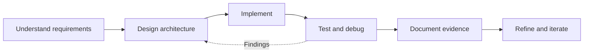

### Designing systems. Building products. Validating results.

**Computing Student @ Bath Spa University** · **London, United Kingdom**

---

## 01 / Engineering Profile

I am **Ozgur Serin**, a Computing student and software developer building practical solutions across **mobile applications, web platforms, explainable artificial intelligence, and network infrastructure**.

My approach is to treat every project as an engineering problem: understand the requirements, make deliberate design decisions, implement maintainable solutions, verify behavior with evidence, and document the outcome clearly.

> **What matters to me:** working software, traceable decisions, repeatable tests, thoughtful user experiences, and honest technical communication.

<table>
<tr><td width="50%" valign="top">

**PRODUCT ENGINEERING**

- React Native and Expo mobile applications
- React-based interfaces and full-stack web development
- Persistent state, navigation and interaction design
- API integration and practical application architecture

</td><td width="50%" valign="top">

**SYSTEMS & RESEARCH**

- Python classification experiments and evaluation
- Explainable, rule-based decision systems
- Cisco Packet Tracer network design and validation
- IP addressing, switching, routing and troubleshooting

</td></tr>
</table>

## 02 / Technical Toolkit

**Languages & Core Development**

**Application Development**

**Tools & Collaboration**

| Discipline | Technologies and practices |
|:--|:--|
| **Mobile engineering** | React Native, Expo SDK 58, Expo Go, navigation, modals, AsyncStorage, iOS device testing |
| **Web engineering** | React, Vite, JavaScript, HTML5, CSS3, Node.js, Express, REST API concepts |
| **AI & data** | Python, rule-based classification, dataset preparation, holdout evaluation, confusion matrices, repeated-split experiments |
| **Network engineering** | Cisco Packet Tracer, TCP/IP, IPv4 subnetting, switches, routers, VLANs, DHCP, DNS, connectivity testing |
| **Engineering workflow** | Git, GitHub, debugging, technical reports, reproducible tests, documentation, team collaboration |

Tools shown represent areas used in projects or learning; they do not imply identical proficiency across every technology.

---

## 03 / Selected Engineering Work

### 01 — QUEST BOX · Gamified Mobile Application

**React Native · Expo SDK 58 · AsyncStorage · iPhone testing**

An interactive challenge-based application designed around short tasks, progression, and persistent engagement.

| Product capability | Implementation focus |
|:--|:--|
| Challenge system | A collection of 12 randomized challenges |
| Progression | XP, levels, achievements and daily streaks |
| Session rules | Three-task daily limit and completion feedback |
| Persistence | Local state stored using AsyncStorage |
| Validation | Tested on a physical iPhone through Expo Go |

**Engineering emphasis:** user-state management, conditional UI, progression logic, local persistence, and device-level verification.

### 02 — SIRIUS · Bilingual Tarot Application

**React Native · Expo SDK 58 · English/Turkish · Product architecture**

A mobile product under active development, designed around a structured card library, interpretation workflows, and a future reader marketplace.

- **78-card library** with upright and reversed interpretations.
- **10 spread formats** and bilingual content.
- Journal and saved-reading concepts for personal reflection.
- Guest-first experience with optional account architecture.
- Supabase authentication and synchronization scaffolding **in development; not represented as production-verified**.
- Marketplace concepts for live chat and video sessions remain **planned/in development**.

**Engineering emphasis:** modular feature design, content modeling, localization, user journeys, and incremental release validation.

### 03 — Explainable AI · Flat vs Hierarchical Rule-Based Classification

**Python · UCI Car Evaluation Dataset · Experimental Design**

**Research title:** *Comparing Flat and Hierarchical Rule-Based AI Systems for Car Acceptability Classification*

A comparative research project investigating how two rule-organization strategies behave on the same categorical classification task.

| Experimental component | Detail |
|:--|:--|
| Dataset | UCI Car Evaluation — **1,728 records** |
| Input features | Six categorical attributes |
| Target | Four acceptability classes |
| Approach A | Flat, sequential IF–THEN decision rules |
| Approach B | Hierarchical rule organization |
| Evaluation | Sealed holdout, repeated train/test splits, per-class analysis and confusion matrices |

**Key insight:** model comparisons depend on evaluation design. The held-out result and repeated-split results did not always favor the same approach; the analysis discusses that variation rather than hiding it.

**Research integrity:** this is presented as a university research project, **not** as a peer-reviewed publication.

### 04 — Cisco Network Engineering · Tested Network Topologies

**Cisco Packet Tracer · IPv4 · Switching · Routing · Troubleshooting**

**University Campus Network** — a 38-device topology configured and tested with successful connectivity checks, including recorded **0% packet loss** in final ping tests.

**Three-Floor Office Network** — a working design with **one Cisco 2911 router, four Cisco 2960 switches and 15 PCs**, using the `192.168.20.0/24` LAN and verified inter-floor communication.

**SeaGoof Ltd Network** — a larger three-floor enterprise-network assignment involving subnet separation, wireless access, shared services and security considerations. **Currently being configured and troubleshot; not claimed as complete.**

**Engineering emphasis:** topology planning, interface configuration, IP addressing, fault isolation, connectivity evidence and technical reporting.

### 05 — Web & Collaborative Software Engineering

**React · Vite · JavaScript · Node.js · Express · GitHub**

Work spanning interactive interfaces, web application architecture, and team-based software delivery, including the **BSU Vault** collaborative university project.

**Engineering emphasis:** version control, shared repositories, integration, requirements communication and individual accountability in group delivery.

  

---

## 04 / How I Engineer Solutions

| Stage | Deliverable I aim for |
|:--|:--|
| **Discover** | Clear scope, assumptions, constraints and acceptance criteria |
| **Design** | Architecture, data flow, network topology or interaction model |
| **Build** | Readable, modular implementation with sensible naming |
| **Verify** | Device tests, ping results, test cases or model evaluation |
| **Explain** | README, screenshots, experiment notes and reproducible steps |
| **Improve** | Tracked issues, fixes, measured outcomes and next iterations |

<b>What I look for in a strong repository</b>

 

- A clear problem statement and explicit project status.
- Installation and execution instructions that someone else can follow.
- Architecture and design decisions with appropriate trade-offs.
- Screenshots or demonstrations that correspond to actual functionality.
- Honest test results, known limitations and next steps.
- Clean version history and no secrets committed to source control.

---

## 05 / Research, Writing & Knowledge Sharing

<table>
<tr><td width="50%" valign="top">

### ResearchGate

Academic interests include **explainable AI, rule-based systems, classification and applied computing research**.

</td><td width="50%" valign="top">

### YouTube

A channel for exploring video-based work and technical communication. See the channel for **actual published videos**; no unverified uploads are claimed here.

</td></tr>
</table>

**Potential demonstration topics:** React Native walkthroughs, AI experiment explanations, Cisco topology configuration and connectivity testing. These are areas of interest, **not a claim that corresponding videos have already been uploaded**.

---

## 06 / GitHub Activity

Statistics are dynamically generated by third-party services and may occasionally be unavailable or incomplete.

---

## 07 / Current Direction

- **Mobile:** strengthen React Native and Expo application architecture, testing and delivery.
- **Backend:** expand API design, authentication, data persistence and service integration.
- **AI:** improve experimental rigor, explainability and research communication.
- **Networking:** build more advanced routed, segmented and service-enabled Cisco networks.
- **Professional practice:** improve automated testing, CI workflows, accessibility and deployment discipline.

**Open to discussing:** junior software development opportunities, especially **React Native / Expo**, collaborative technical projects, and research-oriented computing work.

---

## Let's Build Something Useful

**Code** · **Research** · **Demonstrate** · **Improve**

*Think it. Code it. Create it.*

