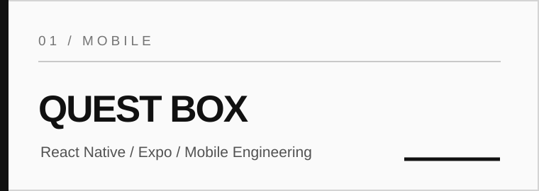
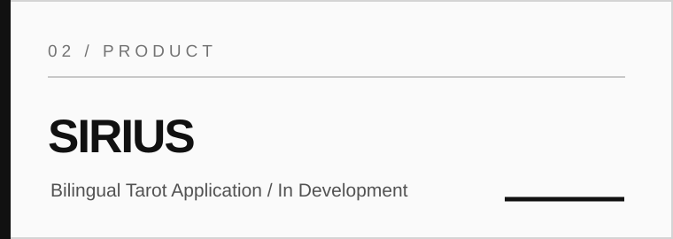
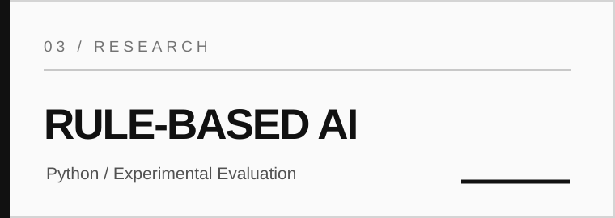
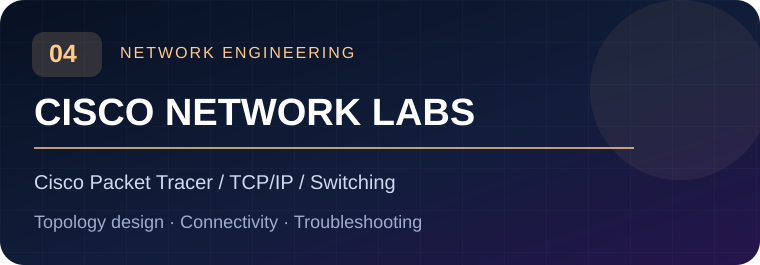

<div align="center">


<br />

**COMPUTING STUDENT · SOFTWARE DEVELOPER · LONDON, UK**

Building practical software, investigating explainable AI, and validating networked systems.

[**GitHub**](https://github.com/Ozgurserin1) &nbsp;·&nbsp; [**ResearchGate**](https://www.researchgate.net/profile/Ozgur-Serin) &nbsp;·&nbsp; [**YouTube**](https://www.youtube.com/@ozgurserins)

</div>

---

## 01 / Profile

I am a Computing student at **Bath Spa University**, developing hands-on experience across mobile applications, full-stack web development, applied artificial intelligence and computer networking. I approach projects as engineering exercises: define the problem, implement a maintainable solution, test it, document the evidence and improve the result.

My current interests include **React Native / Expo**, **Python-based AI**, **React / Node.js**, and **Cisco Packet Tracer**. I am interested in junior software development opportunities, particularly mobile engineering and remote collaboration.

> **Engineering principle:** Clear requirements. Reproducible implementation. Verifiable results.

## 02 / Selected Work

<table>
<tr><td width="50%" valign="top"><br/><b>Quest Box — Mobile Challenge App</b><br/><sub>React Native · Expo SDK 58 · AsyncStorage</sub><br/><br/>A challenge-based mobile app featuring 12 random challenges, XP and levels, daily streaks, badges, completion modals and local persistence. Tested on an iPhone using Expo Go.</td><td width="50%" valign="top"><br/><b>SIRIUS — Bilingual Tarot App</b><br/><sub>React Native · Expo SDK 58 · English / Turkish</sub><br/><br/>An evolving mobile product with a 78-card library, multiple spreads, upright/reversed readings and journaling. Guest mode and Supabase authentication integration remain under development and require further validation.</td></tr>
<tr><td width="50%" valign="top"><br/><b>Flat vs Hierarchical Rule-Based AI</b><br/><sub>Python · Classification · Explainable AI</sub><br/><br/>A comparative university research project using the UCI Car Evaluation dataset (1,728 instances). Implemented two rule-based approaches and assessed them using a held-out test set and repeated splits. Results are discussed with attention to variation across evaluation protocols.</td><td width="50%" valign="top"><br/><b>Network Design & Verification</b><br/><sub>Cisco Packet Tracer · TCP/IP · Routing & Switching</sub><br/><br/>Designed and tested a university campus network and a three-floor office LAN. Projects include IP addressing, device configuration, connectivity checks, fault investigation and technical reporting. Additional enterprise designs are ongoing.</td></tr>
</table>

*Project repositories, demonstrations and documentation can be explored from my [GitHub repositories](https://github.com/Ozgurserin1?tab=repositories). Individual project links are intentionally not invented.*

## 03 / Engineering Toolkit

| Domain | Tools and technologies |
|:--|:--|
| **Mobile** | React Native, Expo, JavaScript, AsyncStorage |
| **Front-end** | HTML5, CSS3, JavaScript, React, Vite |
| **Back-end** | Node.js, Express, REST APIs |
| **Programming & AI** | Python, C++, rule-based systems, data evaluation |
| **Networking** | Cisco Packet Tracer, TCP/IP, switching, routing, VLAN concepts, DHCP and DNS |
| **Workflow** | Git, GitHub, VS Code, technical documentation, testing |

## 04 / How I Work

```text
DISCOVER  →  DESIGN  →  IMPLEMENT  →  TEST  →  DOCUMENT  →  ITERATE
```

**Requirements first.** Translate the brief into measurable behaviours and constraints.  
**Build deliberately.** Keep solutions understandable and easy to review.  
**Test with evidence.** Prefer repeatable checks and recorded results over unsupported claims.  
**Document clearly.** Explain decisions, limitations and next steps.

## 05 / Research & Technical Communication

My academic work explores the practical application and evaluation of rule-based artificial intelligence. A current university research project compares flat and hierarchical rule-based approaches to car acceptability classification. This is described as **university research**, not as a peer-reviewed publication.

- **Research profile:** [ResearchGate — Ozgur Serin](https://www.researchgate.net/profile/Ozgur-Serin)
- **Technical videos and demonstrations:** [YouTube — @ozgurserins](https://www.youtube.com/@ozgurserins)
- **Source code and project documentation:** [GitHub — Ozgurserin1](https://github.com/Ozgurserin1)

## 06 / GitHub & Current Direction

Rather than relying on external statistics images that may fail to load, I keep my public work accessible through GitHub's native pages:

[**Repositories**](https://github.com/Ozgurserin1?tab=repositories) &nbsp;·&nbsp; [**Contribution activity**](https://github.com/Ozgurserin1?tab=overview)

**Currently developing:** mobile app architecture, applied AI evaluation, full-stack engineering practices and network administration. My focus is on producing reliable, well-documented projects with demonstrable results.

---

<div align="center">

**THINK IT. CODE IT. CREATE IT.**

<sub>Ozgur Serin · London, United Kingdom</sub>

</div>
