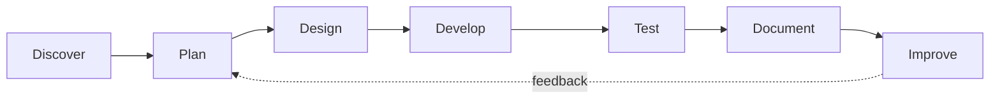

### Building mobile experiences, intelligent systems & reliable networks

**React Native & Expo** &nbsp;•&nbsp; **Full-Stack Web** &nbsp;•&nbsp; **Python & AI** &nbsp;•&nbsp; **Cisco Networking**

*Think it. Code it. Create it.*

---

## 👋 Hello, welcome to my GitHub

I'm **Ozgur Serin**, a **Computing student at Bath Spa University**, based in **London, United Kingdom**. I enjoy transforming ideas into practical software — from mobile apps and interactive websites to explainable AI experiments and real-world network simulations.

My work combines **hands-on development**, **systematic troubleshooting**, **usability**, and **clear technical documentation**. I value projects that are understandable, testable and genuinely useful.

<table>
<tr>
<td width="50%" valign="top">

### 🎯 What I focus on

- 📱 Mobile development with **React Native + Expo**
- 🌐 Responsive **front-end and full-stack** applications
- 🤖 **Rule-based AI** and reproducible evaluation
- 🖧 **Cisco networking** and connectivity testing
- 🧪 Debugging, documentation and continuous improvement

</td>
<td width="50%" valign="top">

### 🌱 Where I'm heading

- Building a stronger portfolio of **production-minded apps**
- Improving **architecture, testing and API integration**
- Exploring **explainable AI** and practical data analysis
- Deepening my knowledge of **network services and security**
- Interested in **junior / remote-friendly developer roles**

</td>
</tr>
</table>

---

## 🧰 My Technology Toolbox

### 🎨 Front-End Development

**HTML5 · CSS3 · JavaScript · React · Vite**

- Responsive layouts with Flexbox and CSS Grid
- Reusable components and interactive interfaces
- Forms, validation, client-side state and navigation
- Accessibility, usability and mobile-friendly presentation

### 📱 Mobile Application Development

**React Native · Expo · JavaScript · AsyncStorage**

- Cross-platform mobile UI and screen navigation
- Interactive modals, local persistence and app state
- Gamification, journals and multilingual content
- Testing on a physical iPhone with Expo Go

### ⚙️ Back-End & Integration

**Node.js · Express · REST APIs · JSON**

- Client–server communication and API-driven interfaces
- Data handling, input validation and error handling
- Authentication concepts and application integration
- Working knowledge of Supabase integration (in progress)

### 🧠 Programming & Artificial Intelligence

**Python · C++ · Rule-Based Systems · Model Evaluation**

- IF–THEN rules and hierarchical decision logic
- Train/test splits, class-level evaluation and confusion matrices
- Experiment reporting and reproducible analysis
- Object-oriented programming and application logic

### 🌐 Network Administration

**Cisco Packet Tracer · TCP/IP · IPv4 · VLANs · DHCP · DNS**

- Network topologies, routers, switches and end devices
- Address planning, default gateways and connectivity tests
- VLAN segmentation and network-service troubleshooting
- Structured fault diagnosis and test evidence

### 🔧 Tools & Engineering Workflow

**Git · GitHub · VS Code · Visual Studio · npm · Technical Writing**

- Version control and collaborative workflows
- Requirements analysis, design and implementation
- Debugging, verification and documented results
- Project READMEs, screenshots and technical reports

---

## 🚀 Featured Work

> These are representative projects and coursework. Some repositories are still being prepared for public release; project titles below are **not** presented as verified public links.

<table>
<tr>
<td width="50%" valign="top">

### 📱 QUEST BOX
**Gamified Challenge App**

A React Native / Expo application that turns short challenges into an engaging daily experience.

**Highlights**
- Randomised challenges
- XP, levels and daily streaks
- Badges and achievement progression
- Completion modals
- Persistent state with AsyncStorage

`React Native` `Expo` `JavaScript`

**Status:** Working mobile prototype

</td>
<td width="50%" valign="top">

### 🔮 SIRIUS TAROT
**Bilingual Mobile Experience**

An evolving mobile app exploring interactive tarot readings and personalised journaling.

**Highlights**
- 78-card library
- Multiple spreads and card interpretations
- English / Turkish content
- Journal and reading experiences
- Optional account and cloud-sync work

`React Native` `Expo` `AsyncStorage`

**Status:** In development; account features not yet verified

</td>
</tr>
<tr>
<td width="50%" valign="top">

### 🤖 CAR ACCEPTABILITY AI
**Explainable Rule-Based Classification**

A research implementation comparing flat decision rules with a hierarchical classifier using the UCI Car Evaluation dataset.

**Highlights**
- Flat IF–THEN decision-list approach
- Hierarchical rule architecture
- Holdout and repeated-split evaluation
- Confusion matrices and class-wise analysis
- Written comparison of experimental results

`Python` `Rule-Based AI` `Evaluation`

**Status:** Research implementation completed

</td>
<td width="50%" valign="top">

### 🖧 CISCO NETWORK PROJECTS
**Network Design & Troubleshooting**

A collection of Packet Tracer projects exploring office and campus networking.

**Highlights**
- Three-floor office network
- University campus topology
- IPv4 addressing and switch configuration
- Ping testing and fault diagnosis
- SeaGoof enterprise network (ongoing)

`Cisco Packet Tracer` `TCP/IP` `VLANs`

**Status:** Mixed — completed labs and ongoing work

</td>
</tr>
</table>

### 💻 Additional Software Engineering Experience

- **Full-stack development:** React interfaces, Node.js / Express integration and API concepts.
- **C++ applications:** Object-oriented programming, openFrameworks and interactive interfaces.
- **Team projects:** Requirements, task planning, GitHub collaboration, testing and documentation.
- **App usability analysis:** Interface evaluation, user testing and evidence-based recommendations.

---

## 🧭 How I Build Software

| Phase | What matters to me | Example deliverable |
|:--|:--|:--|
| **Discover** | Understand the user and the problem | Requirements and scope |
| **Plan** | Choose practical architecture and milestones | Task breakdown |
| **Design** | Prioritise clarity and usability | Wireframes / topology |
| **Develop** | Build incrementally with readable code | Working implementation |
| **Test** | Verify behaviour and diagnose failures | Test results / screenshots |
| **Document** | Make the work understandable and reproducible | README / technical report |
| **Improve** | Iterate based on evidence and feedback | Refined release |

---

## 📊 GitHub Dashboard

> Statistics are generated by third-party services and may occasionally fail to load. Language charts reflect visible repository code, not overall proficiency.

---

## 📚 Learning Roadmap

<b>📱 Mobile Engineering</b>

- Reusable React Native components and navigation
- AsyncStorage and reliable state persistence
- Authentication and cloud data integration
- Accessibility, performance and device testing

<b>🤖 Artificial Intelligence & Python</b>

- Explainable rule-based classification
- Evaluation methodology and error analysis
- Reproducible experiments and clear reporting

<b>🌐 Networking & Infrastructure</b>

- VLAN design and inter-network communication
- DHCP, DNS, web and email services
- Troubleshooting, documentation and security fundamentals

<b>🧩 Software Engineering</b>

- Maintainable architecture and clean code
- Automated testing and debugging
- Team collaboration, code review and version control

---

## 🤝 Let's Connect

I'm interested in collaborating on practical software projects, sharing ideas, and exploring **junior software development opportunities**, especially in **React Native / Expo**.

- 📍 **Based in:** London, United Kingdom
- 🎓 **Studying:** Computing at Bath Spa University
- 💼 **Interested in:** Mobile development, full-stack software and practical engineering
- 🔗 **GitHub:** [github.com/Ozgurserin1](https://github.com/Ozgurserin1)

### ✨ Think it. Code it. Create it.

**Thanks for visiting — explore the projects and follow the journey.**

