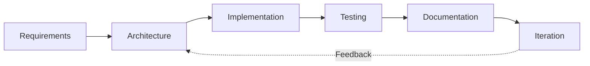

 

**Building practical software, evaluating intelligent systems, and engineering reliable networks.**

---

## 01 / About

I am **Ozgur Serin**, a Computing student at **Bath Spa University**, based in **London, UK**. I develop mobile applications, full-stack web experiences, applied AI experiments, and computer network simulations.

My approach is engineering-led: **understand the problem → design the system → implement → test → document → improve**. I value reproducible results, maintainable code, transparent project status, and clear technical communication.

**Areas of focus:** React Native and Expo · JavaScript and React · Python and rule-based AI · Cisco networking · Software engineering practices.

## 02 / Engineering Toolkit

| Domain | Technologies and methods |
|:--|:--|
| **Mobile** | React Native, Expo SDK 58, JavaScript, AsyncStorage, mobile UI, modal flows |
| **Web** | HTML5, CSS3, JavaScript, React, Vite, Node.js, Express, REST APIs |
| **AI and research** | Python, rule-based classification, dataset preparation, model evaluation, reproducible experiments |
| **Networking** | Cisco Packet Tracer, IPv4 addressing, switching, routing, VLAN concepts, DHCP, connectivity testing |
| **Programming** | JavaScript, Python, C++, SQL fundamentals |
| **Workflow** | Git, GitHub, VS Code, technical documentation, test evidence, iterative development |

## 03 / Selected Work

<table>
<tr>
<td width="50%" valign="top">

**Quest Box — Mobile Gamification**

React Native / Expo project featuring randomized challenges, XP progression, levels, streaks, badges, completion modals, and persistent local storage. Tested on an iPhone using Expo Go.

**Engineering focus:** state management, local persistence, mobile interaction design.
</td>
<td width="50%" valign="top">

**SIRIUS — Bilingual Tarot Platform**

A Turkish/English mobile product in development, with a 78-card library, multiple spreads, interpretation features, and journaling. Optional account sync and marketplace features remain in development.

**Engineering focus:** content architecture, multilingual UX, incremental releases.
</td>
</tr>
<tr>
<td width="50%" valign="top">

**Flat vs Hierarchical Rule-Based AI**

Comparative study using the **UCI Car Evaluation dataset** (1,728 records) to examine flat and hierarchical classification strategies, including a held-out test and repeated data splits.

**Engineering focus:** explainable logic, experimental evaluation, honest interpretation of results.
</td>
<td width="50%" valign="top">

**Cisco Network Design Labs**

Designed and tested university-campus and three-floor office network simulations using Cisco Packet Tracer. Work includes IP planning, device configuration, troubleshooting, and documented ping tests.

**Engineering focus:** network reliability, configuration validation, evidence-based testing.
</td>
</tr>
</table>

## 04 / How I Engineer

**Design for clarity.** Break large problems into components with explicit responsibilities.  
**Test real behaviour.** Prefer observed results over assumptions.  
**Document decisions.** Make projects understandable to collaborators and reviewers.  
**Improve incrementally.** Keep stable baselines while introducing new functionality.

## 05 / Research & Technical Communication

My academic interests include **explainable artificial intelligence, rule-based systems, classification, and software evaluation**. I use research-style methodology to define questions, compare approaches, and report limitations.

- **ResearchGate:** [Ozgur Serin](https://www.researchgate.net/profile/Ozgur-Serin)
- **GitHub:** [Code, experiments and repositories](https://github.com/Ozgurserin1?tab=repositories)
- **YouTube:** [Project demonstrations and technical content](https://www.youtube.com/@ozgurserins)

> Academic coursework and research projects are described as such; they are not represented as peer-reviewed publications unless independently published.

## 06 / GitHub Activity

| Explore | What you will find |
|:--|:--|
| [Contribution activity](https://github.com/Ozgurserin1?tab=overview) | GitHub's native contribution calendar and public activity |
| [Repositories](https://github.com/Ozgurserin1?tab=repositories) | Source code, project history and documentation |
| [Profile overview](https://github.com/Ozgurserin1) | Pinned repositories and current work |

*GitHub-native links are used instead of fragile third-party statistics images.*

## 07 / Current Direction

I am continuing to strengthen my **React Native / Expo engineering**, **full-stack architecture**, **AI experimentation**, and **network administration** skills through practical builds and university projects.

I am interested in opportunities to contribute to real software products, particularly **junior and part-time remote mobile development roles**.

---

### Let's build something useful.

[**Explore my GitHub**](https://github.com/Ozgurserin1) · [**ResearchGate**](https://www.researchgate.net/profile/Ozgur-Serin) · [**YouTube**](https://www.youtube.com/@ozgurserins)

Designed as a project-first engineering portfolio · Updated November 2026

